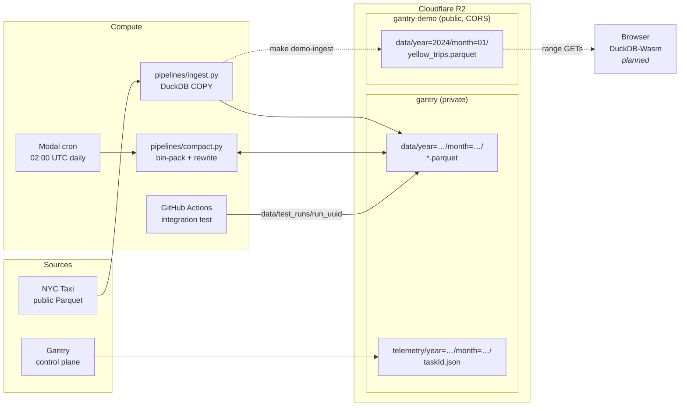

# gantry-lakehouse

[](https://github.com/adamlefevre/gantry-lakehouse/actions/workflows/ci.yml)


[](LICENSE)

**A serverless lakehouse with no servers to run and nothing to pay for while it's idle.** Parquet sits in Cloudflare R2, DuckDB queries it in place over HTTP range requests, and a daily Modal job keeps the files a healthy size.

It's also the analytics store and first target repo for [Gantry](https://github.com/adamlefevre/gantry), a software factory that turns labelled GitHub issues into pull requests.

---

## Architecture



| Layer | Technology | Why |
|---|---|---|
| **Storage** | Cloudflare R2 | S3-compatible with **zero egress fees**, so you can query as often as you like at no extra cost. |
| **Format** | Hive-partitioned Parquet (SNAPPY) | Columnar storage with partition pruning, readable by any engine. |
| **Compute** | DuckDB + `httpfs` | Queries `r2://` URLs directly with range requests. No cluster and no catalog. |
| **Maintenance** | Modal | A real cron that scales to $0 between runs and starts quickly. |
| **CI** | GitHub Actions + PyTest | An end-to-end test against real R2, isolated in a throwaway prefix. |

R2 is accessed two ways:
- **DuckDB** (`TYPE R2` secret) reads and writes Parquet.
- **boto3** lists and deletes objects through the S3 API.

Both clients are built in `pipelines/compact.py` (`init_duckdb()` and `get_s3_client()`), and the Modal job and the tests reuse them.

## Buckets

| Bucket | Visibility | Contents | Credentials |
|---|---|---|---|
| `gantry` | Private, no CORS | Lakehouse `data/` and factory `telemetry/` | `R2_ACCESS_KEY_ID` / `R2_SECRET_ACCESS_KEY` |
| `gantry-demo` | Open CORS (`GET`/`HEAD`) | NYC Taxi sample only, rebuilt with `make demo-ingest` | `DEMO_R2_ACCESS_KEY_ID` / `DEMO_R2_SECRET_ACCESS_KEY` |

Each bucket has its own **API token that only works on that bucket**, so the public demo's keys can't read factory telemetry. The demo bucket's CORS policy exposes `Content-Range`, `Content-Length`, `Accept-Ranges` and `ETag`, so DuckDB-Wasm in a browser can make range reads.

## Compaction

Small files are the main cause of slow object-store queries, because every file costs a round trip. `compact.py` merges them:

```text
discover_small_files ──► pack_batches ──► compact_partition_batch
  .parquet < 32 MB        greedy bins       write compacted-<id>.parquet
  grouped by directory    up to 128 MB      SNAPPY, ~120k-row row groups
  skips compacted-*                         verify row counts match
                                            then delete the source files
```

- Batches with fewer than 2 files are skipped.
- Scope is `data/`, `.parquet` only. `telemetry/` JSON is never touched.
- The source files are deleted only after the row count of the new file matches theirs.

`jobs/scheduled_compaction.py` runs the same loop on Modal every day at **02:00 UTC** (2 CPU, 4 GB, 15-minute timeout). It reads credentials from the Modal secret `r2-credentials`.

## Testing

`tests/test_compaction.py` is an integration test against real R2:

1. Writes 5 synthetic micro-files to a unique prefix, `data/test_runs/run_<uuid>`.
2. Runs compaction on them.
3. Checks that the row counts match and the source files are gone.
4. Deletes the prefix on teardown.

CI runs it on every push and PR to `main` using repository secrets. PRs from forks are skipped, because forks don't get those secrets.

## Quick start

```bash
cp .env.example .env              # fill in Cloudflare account ID + R2 keys
python -m venv .venv
source .venv/bin/activate         # Windows Git Bash: source .venv/Scripts/activate
pip install -r requirements.txt

make init-bucket                  # create the private bucket
make ingest                       # load the NYC Taxi sample
make test                         # run the integration test
```

The Makefile uses bash, so on Windows run it from Git Bash.

## Commands

| Command | What it does |
|---|---|
| `make init-bucket` | Create `R2_BUCKET_NAME` with wrangler |
| `make ingest` | Stream 500k NYC Taxi rows from the public source into R2 |
| `make compact` | Run compaction locally. ⚠️ **Deletes** the source files it compacts |
| `make test` | Run the R2 integration test |
| `make modal-test` | Run the compaction job once on Modal against the real bucket |
| `make modal-deploy` | Deploy the daily cron to Modal |
| `make demo-init` | Create `gantry-demo` and apply the open CORS policy |
| `make demo-ingest` | Load the taxi sample into `gantry-demo` with the demo token |
| `make cors` | Apply the open CORS policy to `R2_BUCKET_NAME`. Intended for the demo bucket only |
| `make clean` | ⚠️ Delete the bucket |

## Repository layout

```text
gantry-lakehouse/
├── pipelines/
│   ├── ingest.py                  # NYC Taxi parquet → R2 via DuckDB
│   └── compact.py                 # small-file bin-packing + shared R2 clients
├── jobs/
│   └── scheduled_compaction.py    # Modal app "gantry-maintenance", daily cron
├── tests/
│   └── test_compaction.py         # ephemeral-prefix integration test
├── docs/
│   ├── design-notes/              # historical design context
│   └── agents/                    # issue tracker, triage labels, domain-doc conventions
├── .github/workflows/ci.yml       # integration test on push/PR
├── .gantry.yml                    # setup config for Gantry factory runs
├── Makefile
└── .env.example
```

## Gantry integration

- **Telemetry:** the Gantry control plane writes one JSON record per task to `telemetry/year=YYYY/month=MM/<taskId>.json` in the private bucket. The record shape is a contract owned by the factory repo (`docs/telemetry.md` there).
- **Target repo:** issues here labelled `ready-for-agent` are picked up by the factory. The only test needs live R2 credentials, which factory sandboxes never get, so for now factory runs here open **draft PRs only**.

## Roadmap

- A browser query UI with DuckDB-Wasm, reading `gantry-demo` directly. This needs public access (r2.dev or a custom domain) turned on for that bucket.
- An offline test suite, so factory runs can open regular, non-draft PRs.
- Possibly a catalog layer such as DuckLake.

## License

[MIT](LICENSE) © 2026 Adam LeFevre

---

Contributors and coding agents: see [`CLAUDE.md`](CLAUDE.md) for working in the code and [`AGENTS.md`](AGENTS.md) for the safety rules.
